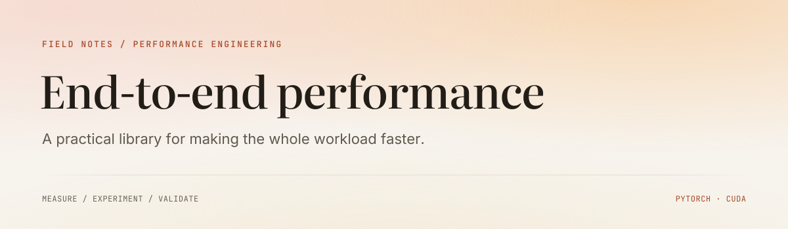
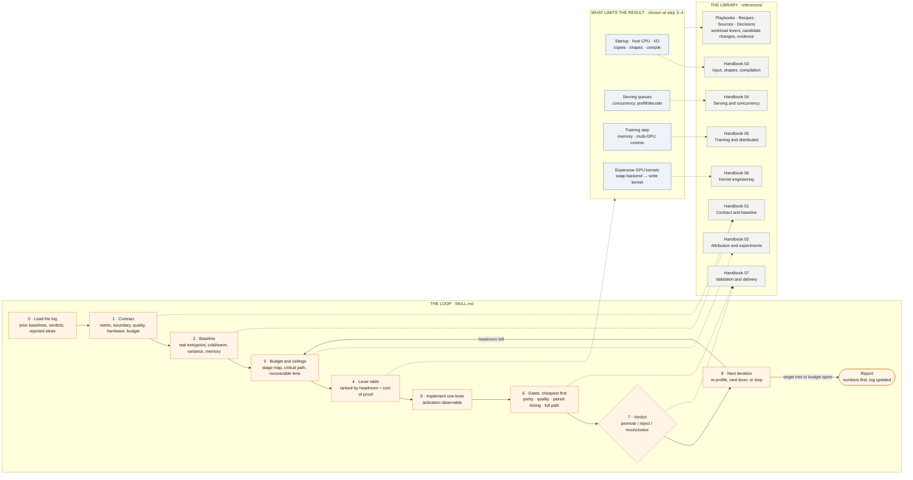

<picture>
  <source media="(prefers-color-scheme: dark)" srcset="assets/readme/cover-dark.svg">
  <source media="(prefers-color-scheme: light)" srcset="assets/readme/cover-light.svg">
  
</picture>

<p>
  <strong>A field guide and agent skill for optimizing complete PyTorch and CUDA workloads.</strong><br>
  Training · inference · serving · distributed systems · GPU kernels
</p>

<p>
  <a href="#start-here">Start here</a> ·
  <a href="#the-handbook">Handbook</a> ·
  <a href="references/README.md">Library</a> ·
  <a href="#use-the-skill">Use the skill</a> ·
  <a href="references/sources/README.md">Sources</a>
</p>

---

## Start here

Find the next useful experiment, estimate what it can save, and validate the
complete delivered workload. Start with the question you need to answer.

`WORKFLOW · START HERE`

### [Choose the next experiment ↗](references/workflow/decision-map.md)

A decision tree from the real workload to a measured bottleneck, a bounded
experiment and a verdict.

---

`HANDBOOK · SEVEN CHAPTERS`

### [Work through the procedure ↗](references/handbook/README.md)

What to check, which tool to use, how to interpret the result and when to stop.
Read the relevant chapter when a step needs more detail.

---

`PLAYBOOKS · WORKLOAD CONTEXT`

### [Find the levers for your workload ↗](references/playbooks/README.md)

Focused guidance for LLM/VLM serving, small model workers and request servers,
with activation checks and parity traps.

---

`SOURCES · 59 ANNOTATED REFERENCES`

### [Read the explanation behind the idea ↗](references/sources/README.md)

Documentation, research and implementations, with a reviewed GPU MODE map and
explicit limits on what transfers to a new workload.

---

## The map

One screen of the whole skill: the eight-step loop an agent runs, where the
measured bottleneck routes the work, and which reference each step opens.
The rule in the picture: enter through `SKILL.md`, read one reference per
step, never the whole library.



Three rules cut across every step: lossless changes first, a diagnostic screen
is never promotion evidence, and the experiment log is the memory between
sessions. The full branch-level flowchart with tool choices and stopping rules
is the [decision map](references/workflow/decision-map.md).

---

## The handbook

**Contract → measure → attribute → change → validate → decide.**

Read in order for the complete workflow, or open the chapter that resolves your
current bottleneck. Each chapter includes entry evidence, procedures, failure
routes and an exit condition.

| | Chapter | The question it answers |
| :--- | :--- | :--- |
| **01** | [Contract & baseline](references/handbook/01-contract-and-baseline.md) | What must become faster, and can we measure it reliably? |
| **02** | [Attribution & experiments](references/handbook/02-attribution-and-experiments.md) | Where is the recoverable time, and what should we try first? |
| **03** | [Input, shapes & compilation](references/handbook/03-input-shapes-and-compilation.md) | Are decode, padding, copies, memory or launch overhead limiting us? |
| **04** | [Serving & concurrency](references/handbook/04-serving-and-concurrency.md) | How do we increase useful throughput while meeting latency and quality limits? |
| **05** | [Training & distributed execution](references/handbook/05-training-and-distributed.md) | How do we improve the complete update and scale across GPUs? |
| **06** | [Kernel engineering](references/handbook/06-kernel-engineering.md) | When is a custom kernel worth it, and which technique fits the bound? |
| **07** | [Validation & delivery](references/handbook/07-validation-and-delivery.md) | Is the gain real, reproducible and ready to use? |

## Use the skill

Clone into a skill directory supported by your coding agent. For a standard
Codex user-level installation:

```bash
git clone https://github.com/anvilarth/end-to-end-performance-skill.git \
  ~/.codex/skills/end-to-end-performance-skill
```

Then invoke it with a repository or launcher and the outcome you need:

```text
Use $end-to-end-performance-skill to optimize this workload.
Entry point: <repository and launch command>
Target: <latency, useful throughput, memory or cost>
Constraints: <hardware, precision, quality and time budget>
```

The skill recovers actual usage from code and existing artifacts, loads only the
relevant references, and reuses the workload's experiment log. New sessions can
resume from prior baselines, decisions and rejected hypotheses.

[Read the agent instructions](SKILL.md) · [Experiment record](references/workflow/experiment-log.md)

## Explore the library

| Collection | Its role |
| :--- | :--- |
| [Workflow](references/workflow/README.md) | The decision protocol: measurement, evidence, experiment budgets and records |
| [Handbook](references/handbook/README.md) | Detailed procedures, tools, commands and failure routes |
| [Recipes](references/recipes/README.md) | Candidate changes for a measured bottleneck |
| [Playbooks](references/playbooks/README.md) | Workload-specific levers and their practical limits |
| [Sources](references/sources/README.md) | Underlying explanations, implementations and provenance |

[The library map](references/README.md) explains where each kind of material
belongs, how the collections connect, and how to add new evidence without
creating competing copies of the same rule.

## What counts as a win

- **Measured headroom.** Rank changes by recoverable end-to-end time and the cost of proving them.
- **Preserved behavior.** Start with equivalent changes; validate the agreed numerical and quality contract.
- **A complete result.** Promote from representative full-path evidence. Record rejected and inconclusive experiments too.

An isolated kernel speedup is one piece of evidence. Success is a faster delivered
training step, batch, generation or served request.

---

Thanks to [GPU MODE](https://github.com/gpu-mode),
[MIT HAN Lab](https://github.com/mit-han-lab),
[Dongyun Zou](https://github.com/DongyunZou), and the contributors to
[KernelWiki](https://github.com/mit-han-lab/KernelWiki) and
[ncu-report-skill](https://github.com/mit-han-lab/ncu-report-skill) for the teaching,
implementation and profiling resources that inform this library.

[Andrei Filatov](https://anvilarth.github.io/blog.html) · [MIT License](LICENSE)
