# End-to-end optimization: decision map

Use this map for an overview of the complete optimization workflow and for choosing
the next diagnostic tool. Read only the branch matching the measured bottleneck.
The detailed recipes remain in the linked references; the map does not require
running every profiler or trying every lever.

For the step-by-step procedure behind a branch, open the matching chapter in
the [performance handbook](handbook/README.md). It supplies entry evidence,
commands, interpretation, failure routes and exit conditions. The
[source library](handbook/sources.md) points to the underlying documentation
and implementations without requiring a full-library read.

- [Decision graph](#decision-graph)
- [Which tool, when, and what decision it supports](#which-tool-when-and-what-decision-it-supports)
- [How far to push each branch](#how-far-to-push-each-branch)
- [Experiment and promotion rules](#experiment-and-promotion-rules)

## Decision graph

The default order is lossless-first. If the user already authorized a particular
precision or algorithm trade-off, it can be ranked alongside other candidates;
do not ask again. Every candidate still needs its declared quality and performance
gates. A successful diagnostic screen is not promotion evidence.

```mermaid
flowchart TB
 subgraph CONTRACT["1. Recover the task and qualify measurement"]
  A["Read launcher, config, git diff,<br/>prior results and rejected ideas"]
  B["Freeze the contract<br/>metric, useful gain, quality, inputs,<br/>precision, hardware, timer boundary,<br/>authorized resources and budget"]
  C["Small real-input control run<br/>check IDs, output completeness and comparator<br/>repeat the control: A/A"]
  D{"Timing and reference suitable<br/>for the declared threshold?"}
  FIX["Repair the harness, inputs or measurement<br/>Missing reference permits diagnostics only;<br/>promotion stays blocked"]
  A --> B --> C --> D
  D -->|No| FIX
  FIX -.->|Targeted retry within budget| C
  FIX -->|Unresolved within budget| INC
 end
 subgraph TRIAGE["2. Find material exposed end-to-end cost"]
  E["Baseline through the real entrypoint<br/>separate cold and warm; memory, errors, tails<br/>wall clock and appropriate GPU events"]
  F["Stage map<br/>startup, input, copy, compute, comms, output<br/>serving: queue, encoder, prefill, decode<br/>training: data, forward, backward, optimizer"]
  G{"Exposed cost and cause<br/>of waiting understood?"}
  H["Short timeline with NVTX<br/>torch.profiler or Nsight Systems<br/>CPU: py-spy, cProfile, I/O counters"]
  I["Estimate recoverable E2E time<br/>critical path and overlap, not summed kernels<br/>no whole-run share from a sampled window"]
  J{"A material authorized lever<br/>can beat the useful threshold?"}
  D -->|Yes| E --> F --> G
  G -->|No| H --> I
  G -->|Yes| I
  I --> J
 end
 subgraph ROUTE["3. Select a branch from evidence"]
  R{"What limits the delivered result?"}
  STARTUP["Startup and loading<br/>repeated imports, model loads or subprocesses?<br/>persistent workers, residency, local copies<br/>include cold cost and process lifetime"]
  HOST["CPU, I/O and input<br/>py-spy, cProfile, pidstat, iostat, strace<br/>in-process or grouped decode<br/>batching and worker pool to a useful plateau"]
  COPY["Copies and synchronization<br/>timeline: memcpy, item, cpu, implicit waits<br/>reusable pinned buffers and prepare-ahead<br/>streams with valid dependencies and lifetime"]
  SHAPES["Shapes and compilation<br/>length distribution, TORCH_LOGS, tlparse<br/>buckets, packing, varlen, regional compile<br/>include packing and compilation amortization"]
  SERVE["Serving and queues<br/>real load, TTFT, TPOT, queue and errors<br/>admission limits, batching, prefix reuse<br/>replicas versus TP; evidence for disaggregation"]
  TRAIN["Training step<br/>profile forward, backward and optimizer<br/>fused loss, norm, optimizer; remove intermediates<br/>preserve loss, gradients, updates and global batch"]
  MEM["Capacity and peak memory<br/>allocated, reserved, snapshot and device memory<br/>remove duplicates, logits and workspace<br/>selective recomputation and cache/shape policy"]
  COMM["Multi-GPU and rank skew<br/>per-rank timeline, topology, nccl-tests<br/>placement, DDP buckets and no_sync<br/>compute/comms overlap and causal/expert balance"]
  GPU{"GPU execution cost:<br/>launch overhead or an expensive kernel?"}
  LAUNCH["Many short launches or underfilled work<br/>batching, fusion and CUDA graphs<br/>workers or MPS when resources allow<br/>useful throughput matters more than utilization"]
  R --> STARTUP & HOST & COPY & SHAPES & SERVE & TRAIN & MEM & COMM & GPU
  GPU -->|Launch overhead| LAUNCH
  J -->|Yes| R
 end
 subgraph KERNELS["4. Escalate kernels only for material E2E headroom"]
  KB{"Compatible fast implementation<br/>or backend already available?"}
  LIB["Inspect dispatch and support conditions<br/>shape, stride, dtype, hardware, backward<br/>propose a backend swap"]
  NCU["If the internal cause is unclear:<br/>Nsight Compute on one real shape<br/>capture canary in the actual worker<br/>bound capture-repair attempts"]
  NCUOK{"Required kernels and counters<br/>or sufficient alternative evidence available?"}
  BOUND{"What do counters and<br/>component measurements show?"}
  BW["Memory traffic or layout<br/>fewer loads, stores and intermediates<br/>coalescing, vectorization, reuse and fusion"]
  TC["Compute or tensor cores<br/>appropriate MMA/backend and tile sizes<br/>epilogue fusion and supported layouts"]
  TAIL["Too few tiles, skew or partial waves<br/>split-K or split-KV, grouped GEMM<br/>persistent or dynamic work distribution"]
  PIPE["Special functions, dependencies or barriers<br/>softmax/reduction fusion and async pipelines<br/>TMA or warp specialization where supported"]
  DSL["Choose by required capabilities and cost<br/>Triton: fusion and simple layouts<br/>TileLang: tiled GEMM, attention, recurrence<br/>Gluon/CuTe: explicit layouts and hardware features<br/>CUDA/CUTLASS: C++ or missing primitives"]
  GPU -->|Expensive kernel| KB
  KB -->|Yes| LIB
  KB -->|Investigate or implement| NCU --> NCUOK
  NCUOK -->|Yes| BOUND
  NCUOK -->|No and repair budget exhausted| INC
  BOUND --> BW & TC & TAIL & PIPE
  BW & TC & TAIL & PIPE --> DSL
 end
 subgraph EXPERIMENT["5. One candidate, cheap falsification, full validation"]
  CARD["Hypothesis record<br/>evidence, one mechanism, low/central/high savings<br/>implementation and validation cost<br/>cheapest falsifier and stop rule"]
  BUDGET{"Budget covers the candidate<br/>and the final representative gate?"}
  BUILD["One reversible change on the accepted stack<br/>independent control; fixed inputs and thresholds<br/>custom kernels: indexing and sanitizer checks as needed"]
  ACTIVE{"Candidate active<br/>and harness functioning?"}
  PARITY{"Outputs and state satisfy the contract?<br/>Training: loss, gradients and updates"}
  SCREEN{"Representative short screen:<br/>plausible useful gain,<br/>acceptable memory and limiting shapes?"}
  FULL["Full gate through the delivered entrypoint<br/>paired control/candidate without profiler overhead<br/>complete manifest, enqueue, drain and publication<br/>scale, topology, tails, memory and quality<br/>training trajectory and resume where required"]
  CERTAIN{"Enough valid evidence<br/>to make the decision?"}
  PASS{"All required quality, performance,<br/>memory and tail gates pass?"}
  ACCEPT["PROMOTE<br/>accept the tested composed stack<br/>save evidence and update baseline/log"]
  REJECT["REJECT<br/>valid evidence falsified the candidate<br/>save why and what would justify retrying"]
  INC["INCONCLUSIVE<br/>comparison invalid or insufficient<br/>repair only the failed gate within budget<br/>or preserve the unresolved boundary"]
  NEXT{"Requested target met?"}
  FINISH["DONE<br/>final metrics, quality and transfer limits<br/>command, revision and artifacts"]
  STOP["STOP WITHIN THE CONTRACT<br/>best tested, not an unproven maximum<br/>name the budget, headroom or blocking limit"]
  STARTUP & HOST & COPY & SHAPES & SERVE & TRAIN & MEM & COMM & LAUNCH & LIB & DSL --> CARD
  CARD --> BUDGET
  BUDGET -->|Yes| BUILD --> ACTIVE
  BUDGET -->|No| STOP
  ACTIVE -->|No| INC
  ACTIVE -->|Yes| PARITY
  PARITY -->|No| REJECT
  PARITY -->|Yes| SCREEN
  SCREEN -->|Valid negative result| REJECT
  SCREEN -->|Insufficient evidence| INC
  SCREEN -->|Promising| FULL --> CERTAIN
  CERTAIN -->|No| INC
  CERTAIN -->|Yes| PASS
  PASS -->|No| REJECT
  PASS -->|Yes| ACCEPT --> NEXT
  NEXT -->|Yes| FINISH
  NEXT -.->|No: cheap updated stage map| F
  REJECT -.->|Another candidate and remaining budget| J
 end
 subgraph TRADEOFF["6. Precision and algorithm changes need their own contract"]
  AUTH{"Specific trade-off authorized,<br/>with budget and a useful hypothesis?"}
  NEWCONTRACT["Declare the permitted change before measuring<br/>separate weight, activation, KV, state and accumulation precision<br/>quality floor and real-input checks"]
  APPROX["Candidate: low-bit, sparsity or approximation<br/>include calibration, packing and conversion costs<br/>reconsider layouts newly enabled by the change"]
  J -->|No material lossless lever| AUTH
  AUTH -->|No| STOP
  AUTH -->|Yes| NEWCONTRACT --> APPROX --> CARD
 end
 classDef prep fill:#e8f1ff,stroke:#4567ab,color:#172b4d
 classDef route fill:#e6f5f4,stroke:#25847b,color:#153d3b
 classDef kernel fill:#fff0db,stroke:#ba7a24,color:#553a15
 classDef gate fill:#fff9d9,stroke:#b4a143,color:#493d06
 classDef good fill:#dff4e4,stroke:#398258,color:#153c24
 classDef bad fill:#fce8e6,stroke:#b55b53,color:#572c27
 classDef neutral fill:#eef0f3,stroke:#7b8795,color:#233042
 class A,B,C,D,E,F,G,H,I,FIX prep
 class J,R,STARTUP,HOST,COPY,SHAPES,SERVE,TRAIN,MEM,COMM,GPU,LAUNCH route
 class KB,LIB,NCU,NCUOK,BOUND,BW,TC,TAIL,PIPE,DSL kernel
 class CARD,BUDGET,BUILD,ACTIVE,PARITY,SCREEN,FULL,CERTAIN,PASS,NEXT gate
 class ACCEPT,FINISH good
 class REJECT bad
 class INC,STOP,AUTH,NEWCONTRACT,APPROX neutral
```

## Which tool, when, and what decision it supports

Use installed-version documentation for flags and supported features. Instrumented
measurements answer diagnostic questions; final timing uses the uninstrumented
delivered workload. Choose the tool that resolves the current uncertainty.

| Question | Tool | Evidence to inspect | Next action or limit |
| --- | --- | --- | --- |
| What is actually being run? | `rg`, `git diff/log`, launcher/config and existing experiment log | Active flags, inputs, shapes, precision, resource limits and prior failures | Recover one reproducible contract before requesting missing information. |
| Is the environment comparable? | `nvidia-smi`, topology output, framework/CUDA/driver versions | Competing load, memory, clocks/power, GPU count and interconnect | Separate environment drift from candidate effects; utilization alone does not identify a bottleneck. |
| How long does useful work take? | Existing E2E harness, `time.perf_counter`, `torch.cuda.Event` | Completed work, cold/warm boundary, errors, outputs, memory and variability | A CPU timer around an asynchronous launch measures enqueue time. Use appropriate completion boundaries without adding global synchronization to the production hot loop. |
| Can the comparator reject wrong outputs? | Independent reference, `torch.equal`, `torch.testing.assert_close`, task-specific evaluator | A/A behavior, expected IDs, missing outputs, state, loss/gradients/updates and deliberately wrong fixtures | Define tolerances before candidates. Structural validity does not establish semantic quality. |
| What waits for what? | [PyTorch Profiler](https://docs.pytorch.org/tutorials/recipes/recipes/profiler_recipe.html), NVTX and [Nsight Systems](https://docs.nvidia.com/nsight-systems/UserGuide/index.html) | CPU/CUDA operations, launch gaps, copies, barriers, queueing and overlap | Use a short representative trace to identify exposed critical-path cost. Summed kernel durations need not equal wall time. |
| Where is Python spending time? | [py-spy](https://github.com/benfred/py-spy) on a running process; `cProfile` on a controlled run | Decode, tokenization, serialization, scheduling and Python loops | Remove repeated work/calls/copies, then size pools. Use native CPU profiling only when the stack points there. |
| Is I/O or process creation the limit? | `pidstat`, `iostat`; targeted `strace -c` | I/O wait, repeated filesystem calls and per-item subprocess creation | Test in-process/grouped decode, buffering and permitted locality/cache changes; preserve preprocessing and segment boundaries. |
| What owns the memory peak? | Allocated/reserved/peak counters, [PyTorch memory snapshot](https://docs.pytorch.org/docs/stable/torch_cuda_memory.html), device memory | Weights, activations, KV/recurrent state, optimizer state, workspace and retained tensors | Attribute before choosing recomputation or batch changes. PyTorch snapshots may omit external allocations such as NCCL. |
| Why does compilation not pay off? | `TORCH_LOGS="graph_breaks,recompiles"`, `TORCH_TRACE` and `tlparse`; [compiler troubleshooting](https://docs.pytorch.org/docs/stable/user_guide/torch_compiler/torch.compiler_troubleshooting.html) | Compiled hot regions, guard failures, compile count/time and shape mix | Test regional compilation, buckets or dynamic shapes; include amortization and recompilation costs. |
| What limits serving? | Real request harness, engine metrics, timeline; compatible engine benchmark tools | Offered load, running/waiting requests, admission limits, TTFT/TPOT, lengths, hits, completions and errors | Distinguish queue, encoder, prefill and decode. Keep realistic input mixtures and full drain; one client's semaphore is not aggregate concurrency. |
| What limits a training step? | `torch.profiler`, loss/gradient/update comparator and existing training logger | Data, forward, backward, optimizer, global batch, accumulation, clipping and checkpoint state | Gate fused operators and recomputation on updates and the required trajectory. A few finite steps only screen. |
| Why does multi-GPU scaling fail? | Relevant-rank timelines, topology, [NCCL tests](https://github.com/NVIDIA/nccl-tests), CUDA P2P tests | Exposed collectives, message sizes, slow ranks, placement and overlap | Fix imbalance/placement before deeper fusion. One-rank traces or a proxy topology cannot establish target-scale performance. |
| Will GPU sharing help? | [MPS](https://docs.nvidia.com/deploy/mps/) daemon/client state and a fixed-workload concurrency sweep | Actual client attachment, aggregate useful throughput, memory, tails and cache contention | Increase authorized workers to the useful plateau; retain the smallest effective count. Higher utilization can coincide with lower throughput. |
| What limits an expensive kernel? | [Nsight Compute](https://docs.nvidia.com/nsight-compute/ProfilingGuide/index.html), initially on one real shape | Intended kernels, memory traffic, compute pipes, stalls, registers/spills, grid and tails | Ask a narrow question and bound capture repairs. Replay timing is not final application timing. |
| Which implementation should be tried? | Existing dispatch/backend flags, fused operators, compiler, then a suitable kernel DSL | Shape/dtype/stride/device/backward support and required scheduling features | Prefer a compatible implementation before custom code. Use [kernel-dsls.md](kernel-dsls.md) and [advanced recipes](advanced-recipes.md) for deeper selection. |
| Is a custom kernel correct? | Small index/layout examples, Triton interpreter/Viz and [Compute Sanitizer](https://docs.nvidia.com/compute-sanitizer/ComputeSanitizer/index.html) as applicable | Tails, strides, address range, aliasing, mutation, invalid/uninitialized accesses and synchronization hazards | Interpreter checks do not prove GPU race freedom; sanitizers do not prove mathematical or model-quality equivalence. |
| Which kernel configuration pays off? | `torch.utils.benchmark`, Triton benchmarking/autotuning, bounded DSL search; PyGPUBench where isolation is needed | Representative shapes, warmup/cache policy, restored mutable state, independent reference and search cost | Cache validated choices with device/version/shape/dtype/layout identity and a fallback. Return microbenchmark wins to the E2E gate. |
| Is the change accepted and reusable? | Existing experiment log and paired E2E report | Absolute control/candidate metrics, variability, coverage, quality, memory and transfer limits | Record promote/reject/inconclusive, artifacts and reopening conditions. Revisit rejected ideas only when relevant evidence changes. |

## How far to push each branch

| Branch | First useful move | Deeper move if measured headroom remains | Stop condition |
| --- | --- | --- | --- |
| Startup | Remove repeated loading/imports/process creation; retain workers | Locality, load format and compilation policy | Actual process lifetime does not amortize setup. |
| CPU/input | Remove duplicate decode/transforms and calls | Grouped decode, batching, buffers and pool sizing | Feeding no longer limits E2E or more workers stop helping. |
| Transfers | Remove needless host reads/waits and reuse buffers | Pinned staging, prepare-ahead and copy streams | No independent work exists, overlap fails, or staging costs erase savings. |
| Shapes/compile | Measure lengths and padding; inspect recompiles | Buckets, varlen, regional/dynamic compilation | Packing, conversion, graph memory or recompilation exceeds the gain. |
| Memory | Identify the owner of the peak and remove unnecessary materialization | Selective recomputation or cache/workspace policy | Capacity no longer limits the real workload or extra compute loses the benefit. |
| Serving | Separate queue, encoder, prefill and decode; inspect admission | Batching, real prefix reuse, replicas versus TP, justified disaggregation | Useful throughput plateaus or declared latency, error, memory or quality limits bind. |
| Training | Separate forward/backward/optimizer and verify update semantics | Fused loss/optimizer, compilation and selective recomputation | Objective, gradients or updates change outside the contract, or the full step does not improve. |
| Distributed | Identify slow ranks, topology and exposed communication | Buckets, DDP accumulation policy and supported compute/comms overlap | Communication is hidden already or resource contention makes overlap slower. |
| Launch overhead | Batch, fuse or capture supported repeated work | Multiple workers/MPS when resources permit | Remaining time is kernel work or sharing hurts cache/memory/tails. |
| Memory-bound kernel | Reduce materialization and traffic; improve layout | Reuse, vectorization and producer/consumer fusion | Remaining E2E gain is too small to repay implementation and validation. |
| Compute or underfilled kernel | Compatible library/MMA path and shape-appropriate tiles | Split-K/KV, grouped/persistent scheduling and architecture-supported pipelines | Reduction/queue/resource costs erase gains; no universal utilization threshold proves completion. |
| Precision/algorithm | Apply only the specifically authorized change and gate | Reconsider layouts enabled by lower memory use | Quality fails or preparation/conversion costs erase E2E savings. |

For hybrid models, attribute attention, causal convolution, recurrent state,
routing and expert GEMMs separately. Validate state across chunks, resets and
batch reordering. For multimodal prefix reuse, matching placeholder tokens alone
does not establish matching media or preprocessing.

Speculative decoding is a separate candidate when the contract permits it; include
draft, verification and memory costs and validate the required output behavior.
Do not import a no-draft restriction from another task or disregard one in this task.

## Experiment and promotion rules

1. **Define useful work.** Output tokens/s, input-plus-output tokens/s, completed
   requests/s and time-to-quality are distinct metrics. Check the executed formula,
   finish reasons, errors and missing outputs. Keep cold and warm boundaries separate.
2. **Estimate before implementing.** For non-overlapping fraction `p` and local
   speedup `s`, `E2E speedup = 1 / ((1 - p) + p / s)`. Removing a 15% stage entirely
   can yield at most about `1.176x`. Overlap requires exposed critical-path analysis.
3. **Rank on one usage horizon.** Use expected E2E seconds saved times confidence
   divided by setup, implementation and validation cost. Record low/central/high
   savings, assumptions, a cheap falsifier and a stop rule. For comparable calls,
   extra setup `C` and saving `d > 0` imply approximately `C / d` break-even calls.
4. **Keep one mechanism per arm.** Preserve the independent control and fixed
   inputs/thresholds. Prove activation before a costly run. Restore inputs/state
   changed by warmup or autotuning; avoid competing measurements on the same GPU.
5. **Falsify cheaply, validate completely.** A short representative screen can
   reject or prioritize. Promotion uses fresh paired measurements through the
   installed package, CLI or server, including required quality, memory, tails,
   topology, output completeness and training trajectory/resume checks.
6. **Distinguish outcomes.** Reject means valid evidence violates the contract.
   Inconclusive means the comparison is invalid or insufficient. Fix only the
   failed gate within the remaining budget, or preserve the unresolved boundary.
   Never widen tolerances or discard controls to rescue a candidate.
7. **Validate composition.** Test the current accepted stack plus the candidate.
   If packaging later changes imports, ordering, synchronization or backend choice,
   repeat affected gates. After a win, update the stage map cheaply before choosing
   another lever; do not add isolated speedup factors together.
8. **Stop deliberately.** Stop at the validated target, exhausted useful headroom,
   exhausted budget or a decision that requires user input. Preserve the best tested
   setup and untested boundaries. Track time to a valid baseline, a decisive result
   and accepted delivery as well as workload speed.

Continue with [measurement and parity](measurement-and-parity.md),
[experiment budgeting](experiment-loop.md), [common bottleneck recipes](bottleneck-recipes.md),
[advanced recipes](advanced-recipes.md), or the relevant [workload playbook](playbooks/README.md).
