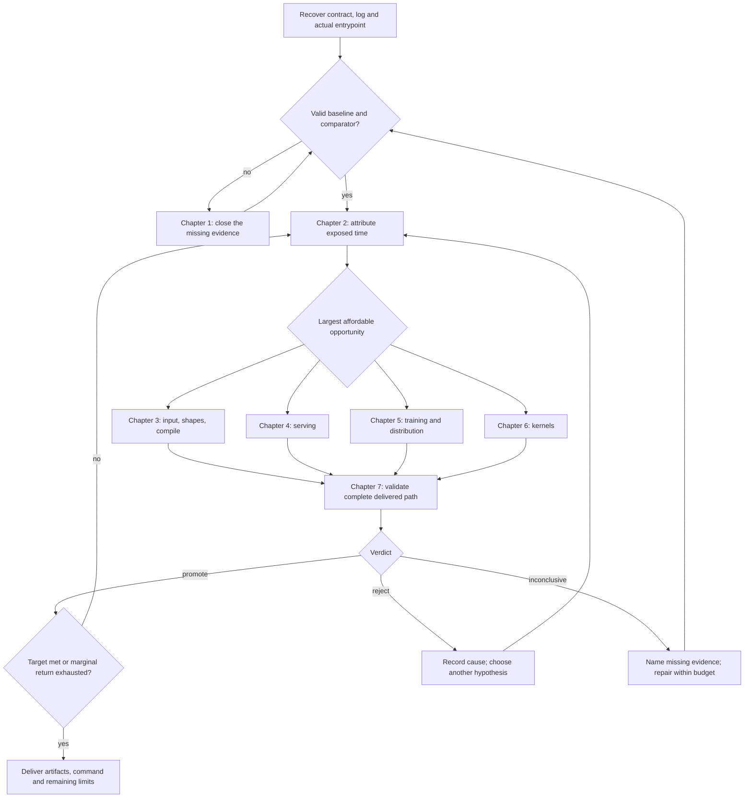

# Performance engineering handbook

Use this library while making a specific optimization decision. Start with the
[decision map](../decision-map.md), identify the missing evidence, and open one
chapter below. Reading every chapter before measuring is unnecessary. The
chapters expand the skill's loop; they do not create a second workflow or log.

## Choose the next chapter

| Current question | Chapter | Leave with |
| --- | --- | --- |
| What exactly must become faster, and can I reproduce it? | [1. Contract and baseline](01-contract-and-baseline.md) | Frozen workload, runnable control/comparator, stable baseline and metric definition |
| Where is the recoverable time, and which experiment comes first? | [2. Attribution and experiments](02-attribution-and-experiments.md) | Causal evidence, bounded savings estimate, cheapest falsifier and stop rule |
| Is input handling, padding, allocation or compilation wasting time? | [3. Input, shapes and compilation](03-input-shapes-and-compilation.md) | A measured change to useful work, staging, memory or execution overhead |
| How do I improve request throughput without destroying latency or quality? | [4. Serving and concurrency](04-serving-and-concurrency.md) | A load-tested configuration with valid outputs, cache policy and tails |
| Is the training step limited by compute, optimizer, memory or communication? | [5. Training and distributed execution](05-training-and-distributed.md) | A validated complete update and scaling decision |
| Which kernel technique fits the measured bound? | [6. Kernel engineering](06-kernel-engineering.md) | A contract-compatible implementation whose integration saves time |
| Is this enough evidence to promote, compose and ship? | [7. Validation and delivery](07-validation-and-delivery.md) | An explicit verdict, reproducible delivery and a resumable record |
| Where is the primary explanation, API or implementation? | [Source library](sources.md) | A source matched to the question, with its transfer limits |

For a familiar workload, the existing [class playbooks](../playbooks/README.md)
provide concrete levers. [Bottleneck recipes](../bottleneck-recipes.md) and
[advanced recipes](../advanced-recipes.md) are compact experiment menus. The
[GPU MODE map](../gpu-mode-map.md) locates reviewed repositories and lectures;
the source library adds upstream documentation and research. Avoid loading all
three menus when one answers the question.

## The working sequence

This sequence expresses dependencies, not seven mandatory profiling passes.
Reuse valid evidence. A measured two-minute model reload can justify a residency
experiment immediately; it does not require kernel counters first. An unknown
20 ms gap may require a timeline before choosing any implementation.

If only an acceptance reference is missing, useful diagnostics may proceed under
an explicit provisional contract. Promotion remains unavailable until the
required reference and gate are restored; avoid repeating baseline setup that
is already valid.

## How to apply a procedure

Every chapter identifies entry evidence, actions, interpretation, failure paths
and an exit condition. For each candidate keep one compact record in the
[existing experiment log](../experiment-log.md):

1. **Observation:** artifact, workload scope, absolute time and variability.
2. **Hypothesis:** mechanism and the one change expected to affect it.
3. **Prediction:** low/central/high end-to-end savings; dependencies and cost.
4. **Falsifier:** smallest real-input experiment that could reject the mechanism.
5. **Gate:** correctness, quality, performance and resource constraints.
6. **Decision:** promote, reject or inconclusive, with artifact paths and next step.

Treat all numerical examples in these chapters as illustrative calculations,
not measurements of a particular GPU or promises of speedup. Command examples
are templates: substitute the real launcher, input manifest and supported flags.
Keep reports in the task's authorized artifact directory. Match documentation
to the installed versions before borrowing APIs or profiler options.

## Common detours and the shorter route

| Temptation | Evidence that changes the decision |
| --- | --- |
| Start rewriting an attention kernel | First establish attention's exposed share, current backend and supported shapes |
| Profile everything with every tool | Ask one question; choose the cheapest tool that can answer it |
| Increase batch size because memory is free | Measure useful throughput, latency, padding, queue behavior and complete-step memory |
| Treat high GPU utilization as success | Count useful completed work and identify compute, bandwidth, stalls and wasted work |
| Read more papers after a failed experiment | Close the failure cause; search only for the missing mechanism |
| Keep tuning the fastest microbenchmark | Check whether integration, transfers or a moved bottleneck erase its benefit |
| Retry a noisy final benchmark until it wins | Use the stopping rule fixed before measurement; report an unresolved result |
| Forget a failed approach next session | Record its valid scope and the specific evidence that would justify reopening it |

## Keeping the library useful

Add a new recipe when an observed failure or reusable decision is missing, not
merely because another link exists. Put the procedure in the relevant chapter,
link its primary source in [sources.md](sources.md), and state applicability,
failure modes and acceptance evidence. Pin source revisions when importing code
or relying on a specific benchmark implementation. Keep private manifests,
traces, credentials and session transcripts in the workload's own workspace.

For updates, check links and routing, walk a realistic case through the affected
branch, and distinguish documentation checks from executed GPU validation.
